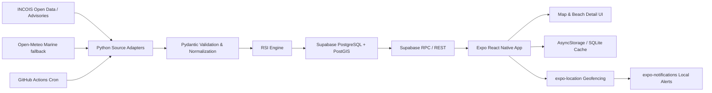

# Beach Mood — System Architecture

**Version:** 1.0  
**Locked stack:** Expo React Native + TypeScript; NativeWind; Reanimated; react-native-maps; expo-location; expo-notifications; Supabase PostgreSQL/PostGIS; Python FastAPI/ingester; AsyncStorage or expo-sqlite; INCOIS/Open-Meteo Marine.

## 1. Architecture overview

The mobile client is read-mostly. Python adapters retrieve external feeds, normalize and validate them, compute the versioned RSI, then upsert snapshots and alerts into Supabase. The client reads through Supabase's public anon key under RLS. No service-role credential is shipped in the app.



### Responsibilities

| Component | Responsibility |
|---|---|
| Expo app | Map, detail, search/filter, permissions, local cache, local geofence notifications |
| Supabase | Beach catalogue, latest condition snapshots, alert records, spatial lookup, RLS |
| Python ingestion | Source-specific HTTP adapters, schema validation, unit normalization, RSI, idempotent sync |
| GitHub Actions Cron | Scheduled execution and logs; no always-on server required |
| FastAPI (optional) | Health/status endpoint or controlled manual ingestion trigger; never expose privileged ingestion unauthenticated |
| Open-Meteo Marine | Fallback for selected marine forecast fields only; never replaces official emergency advisories |

## 2. Data flow

1. Scheduler starts ingestion.
2. Adapter fetches a source with explicit timeout and bounded retries.
3. Raw payload metadata is recorded in logs; normalized Pydantic models validate units, coordinates, timestamps and alert validity.
4. RSI engine computes status and reason codes using a pinned `scoring_version`.
5. Transactional upsert writes latest beach condition and alert records.
6. Supabase RPC serves nearby beaches using PostGIS.
7. App reads catalogue/conditions; cache is updated only after successful response.
8. Geofence configuration is generated from nearby hazardous/advisory beaches, constrained by OS region limits.
9. `expo-location` emits entry/exit events; the app schedules a local notification through `expo-notifications`.

## 3. Spatial query pipeline

Store beach coordinates as `geography(Point, 4326)` so `ST_DWithin` uses metres. Create a GiST index. A query:
- constructs the user's point from longitude/latitude,
- filters with `ST_DWithin(beaches.location, user_point, radius_meters)`,
- calculates distance using `ST_Distance`,
- joins the latest condition snapshot,
- orders by distance.

`ST_DWithin` can use the GiST spatial index to narrow candidates before exact distance calculation. Avoid wrapping the indexed column in arbitrary transformations in the predicate. Validate query plans with `EXPLAIN (ANALYZE, BUFFERS)` against realistic seed volume.

## 4. Geofencing and local notifications

The app requests foreground location first. Background location is requested only after explaining why it is needed and only if the user enables hazard approach alerts. The app registers a bounded list of regions (OS limits vary by platform/version; maintain a conservative app-level cap such as 20 and test target devices). Prefer nearest beaches with active Hazard/Warning status, plus selected saved beaches if implemented.

On a geofence event:
- verify event type is `Enter`,
- map region identifier to a beach,
- suppress duplicate alerts for a cooldown window,
- schedule an immediate local notification,
- avoid claiming the beach is currently dangerous if the cached alert has expired; include advisory timestamp/status age.
- On next foreground launch, refresh the region set and status.

A local geofence notification is not a server push. It depends on OS background permission, region monitoring availability, device settings, and app configuration. It cannot guarantee delivery, especially after permission revocation, force-stop, device restart, or OS restrictions. Expo background location/geofencing requires native configuration and a development build; verify current Expo SDK support and platform-specific requirements.

## 5. Security boundaries

- App contains only Supabase project URL and anon/public key.
- RLS grants public `SELECT` only on published beach and latest public condition views/tables.
- Ingestion uses service-role key only in GitHub Actions secrets or protected server environment.
- Never expose a public unauthenticated endpoint that triggers service-role writes.
- Validate all source payloads; treat external strings as untrusted.
- Use HTTPS; avoid storing user GPS history.
- Rotate credentials after accidental exposure.

## 6. Project structure

```text
beach-mood/
├── apps/
│   └── mobile/
│       ├── app/
│       │   ├── _layout.tsx
│       │   ├── index.tsx
│       │   ├── beach/[id].tsx
│       │   └── settings.tsx
│       ├── src/
│       │   ├── components/
│       │   │   ├── map/BeachMap.tsx
│       │   │   ├── map/BeachMarker.tsx
│       │   │   ├── beach/BeachSummarySheet.tsx
│       │   │   ├── beach/StatusBadge.tsx
│       │   │   └── common/OfflineBanner.tsx
│       │   ├── hooks/useUserLocation.ts
│       │   ├── hooks/useNearbyBeaches.ts
│       │   ├── hooks/useGeofences.ts
│       │   ├── lib/supabase.ts
│       │   ├── lib/cache.ts
│       │   ├── lib/notifications.ts
│       │   ├── services/beaches.ts
│       │   ├── types/domain.ts
│       │   ├── utils/format.ts
│       │   └── theme/tokens.ts
│       ├── assets/
│       ├── app.json
│       ├── babel.config.js
│       ├── metro.config.js
│       ├── tailwind.config.js
│       ├── tsconfig.json
│       └── package.json
├── services/
│   └── ingestion/
│       ├── app/
│       │   ├── __init__.py
│       │   ├── config.py
│       │   ├── models.py
│       │   ├── sources/base.py
│       │   ├── sources/incois.py
│       │   ├── sources/open_meteo.py
│       │   ├── scoring/rsi.py
│       │   ├── repository/supabase_repo.py
│       │   └── main.py
│       ├── tests/
│       ├── requirements.txt
│       └── .env.example
├── supabase/
│   ├── migrations/001_initial_schema.sql
│   └── seed.sql
├── .github/workflows/ingest.yml
├── docs/
│   ├── PRD.md
│   ├── ARCHITECTURE.md
│   ├── DATABASE.md
│   ├── API.md
│   ├── DESIGN.md
│   ├── ENGINEERING_GUIDELINES.md
│   └── ROADMAP.md
└── README.md
```

## 7. Deployment model

- Supabase Free project hosts PostgreSQL/PostGIS and REST/RPC.
- GitHub Actions scheduled workflow runs Python ingestion. Cron schedules can be delayed and are not a guaranteed real-time scheduler; UI must show actual data timestamps.
- Optional FastAPI service can expose `/health` and read-only diagnostics. If deployed on a free sleeping service, cold starts and uptime are expected.
- Mobile builds use Expo development builds for native geofencing validation; Expo Go is not sufficient for all native/background behavior.

## 8. Failure behavior

| Failure | Required behavior |
|---|---|
| Source timeout | Retry boundedly; retain last good snapshot; update ingestion error telemetry |
| Invalid/missing parameter | Store null with quality/reason metadata; never coerce to zero |
| Supabase unavailable | Ingestion exits non-zero; client uses cache and stale banner |
| No GPS permission | Map remains usable; nearby feature offers manual search |
| Geofence unavailable | Explain and retain in-app map advisories |
| Offline cache empty | Show connectivity empty state and emergency disclaimer |
